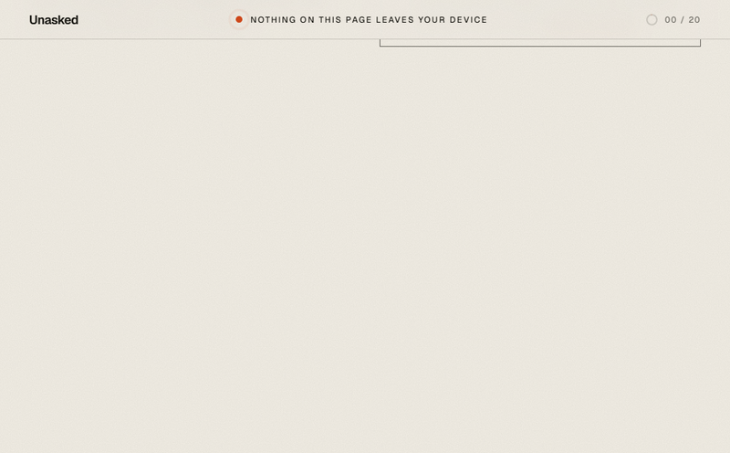
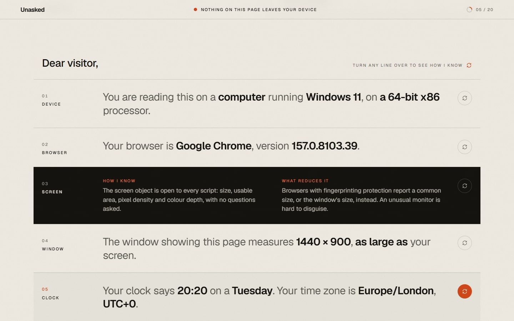
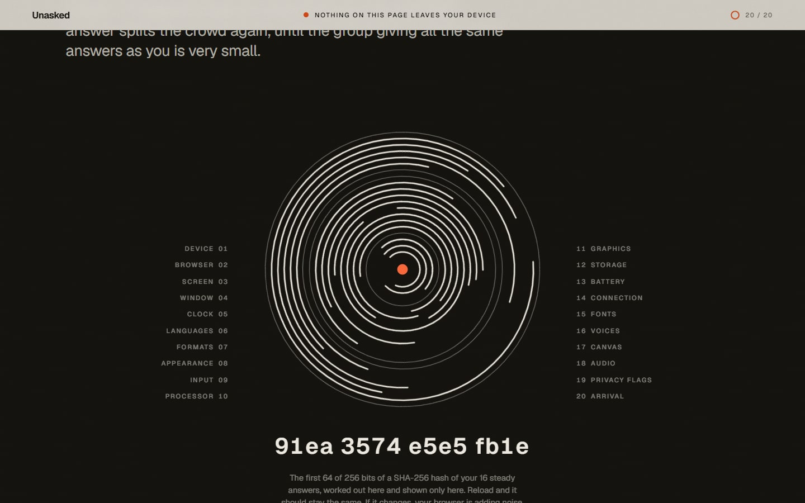
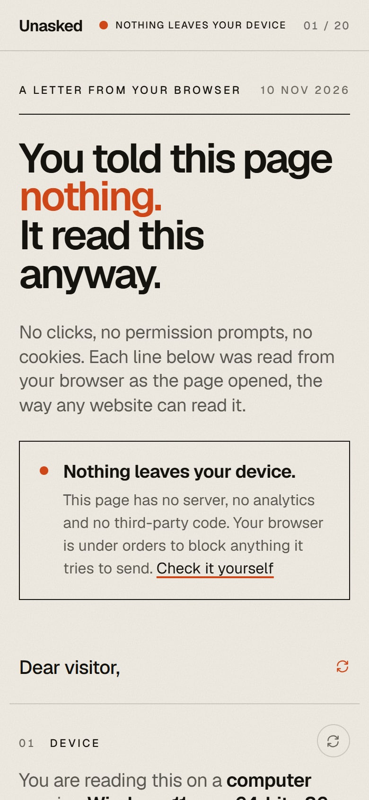
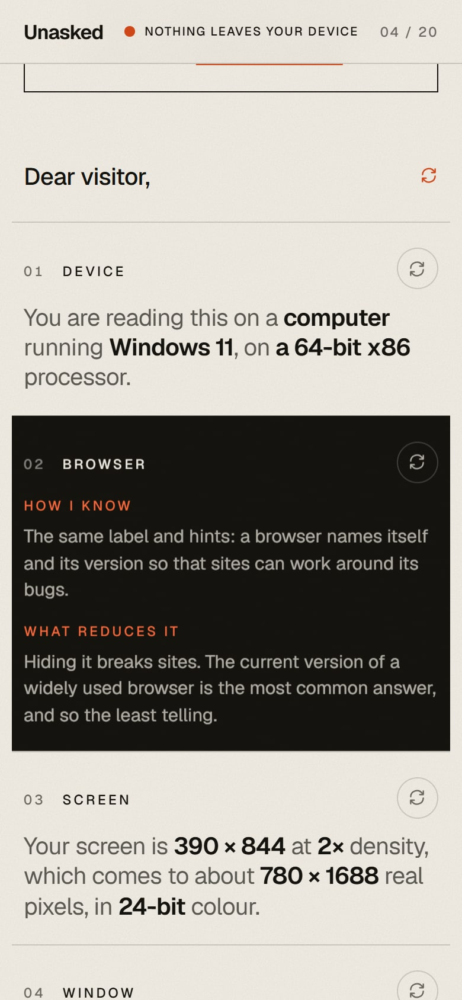
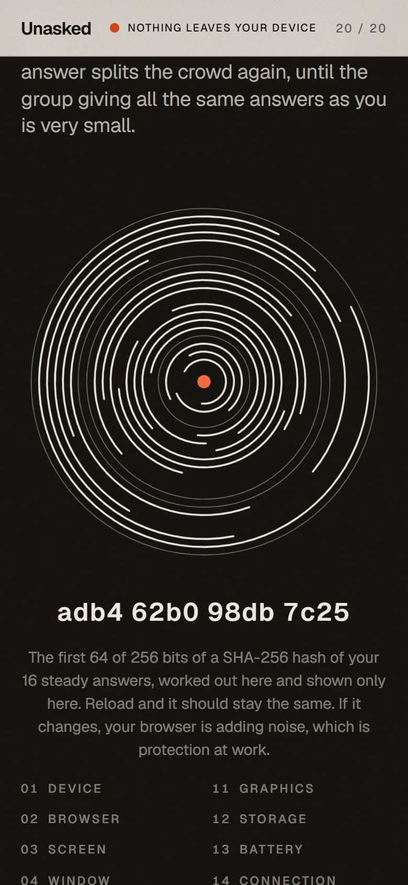

<picture>
  <source media="(prefers-color-scheme: dark)" srcset="assets/hero-dark.svg">
  
</picture>

<p align="center">
  <a href="https://pratyushshivam.github.io/unasked/"><b>Open the letter</b></a> ·
  <a href="#what-it-reads">What it reads</a> ·
  <a href="#nothing-leaves-your-device">The promise</a> ·
  <a href="#run-it">Run it</a> ·
  <a href="https://www.pratyushshivam.com/">pratyushshivam.com</a>
</p>

# Unasked

**A letter your browser writes about you.** Open the page and, with no clicks and no permission prompts, it types out twenty plain sentences: your device, your screen, your time zone, your fonts, your graphics chip, how you write a date. Every one of them is something any website can read the moment you arrive.

Each line turns over to show how the page found it out and what reduces it. At the end the twenty answers travel into a single mark, the page explains honestly what that mark does and does not say about you, and it tells you what you can do.

All of it is worked out on your own device. **Nothing is sent anywhere**, and the page is built so that you can check.

**Open it:** [pratyushshivam.github.io/unasked](https://pratyushshivam.github.io/unasked/)

<a href="https://pratyushshivam.github.io/unasked/"></a>

<table>
<tr>
<td width="50%" valign="top"><br><sub><b>The letter.</b> Line three is turned over.</sub></td>
<td width="50%" valign="top"><br><sub><b>The mark.</b> One ring for each thing the page read.</sub></td>
</tr>
</table>

<table>
<tr>
<td width="33%" valign="top"></td>
<td width="33%" valign="top"></td>
<td width="33%" valign="top"></td>
</tr>
</table>

<p align="center"><sub>The same page on a phone. It works by touch and by keyboard, and respects reduced motion.</sub></p>

| | |
| :-- | :-- |
| **What it is** | One static page. No server, no account, no cookie, no storage |
| **What it reads** | Twenty things a browser gives to any page without a prompt |
| **What it never does** | Ask for a permission, or read anything that needs one |
| **What it sends** | Nothing. A Content-Security-Policy with `connect-src 'none'` makes the browser enforce that |
| **Size** | About 140 kB for the page, its script, its styles and one font file |
| **Stack** | TypeScript and Vite. No framework and no dependencies at run time. Signal modules are pure and tested |

## What it reads

Every line states only what the browser actually reported. Where a browser hides a value, the line says so, and the mark draws that ring as a dotted one. Nothing is guessed.

| Line | What it says | How the page knows |
| :-- | :-- | :-- |
| **Device** | Kind of device, operating system, processor family | The User-Agent label and User-Agent Client Hints. [`device.ts`](src/signals/device.ts) |
| **Browser** | Name and version | The same. [`browser.ts`](src/signals/browser.ts) |
| **Screen** | Size, pixel density, colour depth, space taken by a taskbar | The `screen` object. [`screen.ts`](src/signals/screen.ts) |
| **Window** | Size of the window, as a share of the screen | `innerWidth` and `innerHeight`. [`window.ts`](src/signals/window.ts) |
| **Clock** | Local time, time zone, offset from UTC | `Intl.DateTimeFormat`. [`time.ts`](src/signals/time.ts) |
| **Languages** | The languages the browser asks sites for, in order | `navigator.languages`. [`languages.ts`](src/signals/languages.ts) |
| **Formats** | How you write a date, a time and a large number | The `Intl` formatting API. [`formats.ts`](src/signals/formats.ts) |
| **Appearance** | Light or dark, motion, contrast, colour range, HDR | CSS media queries. [`appearance.ts`](src/signals/appearance.ts) |
| **Input** | Mouse or touch, touch points, keyboard layout | Media queries, `maxTouchPoints`, the Keyboard API. [`input.ts`](src/signals/input.ts) |
| **Processor** | Threads, and a rounded memory figure | `hardwareConcurrency`, `deviceMemory`. [`hardware.ts`](src/signals/hardware.ts) |
| **Graphics** | The graphics chip and the drawing API | The WebGL renderer string. [`graphics.ts`](src/signals/graphics.ts) |
| **Storage** | How much the site would be allowed to keep | `navigator.storage.estimate()`. [`storage.ts`](src/signals/storage.ts) |
| **Battery** | Level and whether it is charging | `navigator.getBattery()`, where it still exists. [`battery.ts`](src/signals/battery.ts) |
| **Connection** | Rated speed, round trip, data saver | The Network Information API. [`connection.ts`](src/signals/connection.ts) |
| **Fonts** | Which of 52 fonts are installed | Measuring a test word on a hidden canvas. [`fonts.ts`](src/signals/fonts.ts) |
| **Voices** | Text-to-speech voices and their languages | `speechSynthesis.getVoices()`. Nothing is spoken. [`voices.ts`](src/signals/voices.ts) |
| **Canvas** | A hash of how the machine renders a hidden picture | Drawing off-screen and reading the pixels back, twice. [`canvas.ts`](src/signals/canvas.ts) |
| **Audio** | A number from the audio stack | Rendering a tone in an offline audio context. Nothing is played. [`audio.ts`](src/signals/audio.ts) |
| **Privacy flags** | Cookies, Do Not Track, Global Privacy Control | Plain properties of `navigator`. [`privacy.ts`](src/signals/privacy.ts) |
| **Arrival** | The site you came from, and how many pages the tab remembers | `document.referrer`, `history.length`. [`arrival.ts`](src/signals/arrival.ts) |

Several of these have been cut back by browsers in recent years, and the page is written for what they report today. The operating system's version is taken only from client hints, because the old label is frozen. The storage figure is described as what it now is in Chromium, usage plus a fixed 10 GiB, and not as a measure of your disk. The battery, connection, memory and keyboard lines simply say "your browser keeps this to itself" in browsers that never shipped those APIs or have removed them.

**One thing it cannot show** is your IP address. Every server sees it, and this page has no server to read it back to you. The page says so.

## The mark, and what it does not claim

At the end, each of the twenty signals travels to the centre and becomes a ring. A ring's shape comes from a hash of the answer, so the same answers always draw the same mark. Answers that hold still between visits are solid arcs. Answers that change by the minute (window, battery, connection, arrival) are thin circles and are left out of the hash. Answers the browser refused are dotted.

Under the mark is the first 64 bits of a SHA-256 hash of the steady answers, computed by the browser's own Web Crypto. Reload and it stays the same, which is the point: a site does not have to store anything on your device to recognise it. If it changes on reload, your browser is adding noise, and that is protection at work.

**The page does not tell you that you are "one in N".** It cannot know. That figure needs everybody else's answers to compare yours with, which means collecting them, and this page collects nothing. What it does instead:

- It explains the idea accurately: an answer shared by half of all browsers carries one bit of identifying information, bits add up when answers are unrelated, and 33 bits are enough to tell apart everyone alive (2<sup>33</sup> = 8,589,934,592).
- It says why the simple sum overstates things: real answers are correlated, so the true figure can only be measured against a real crowd.
- It quotes two measurements that were made with consent, with their sample sizes: 83.6% of 470,161 browsers unique in the EFF's Panopticlick study (2010), and 33.6% of 2,067,942 on a large French website (2018).
- It computes only what can be computed locally: how many things it looked for, how many were answered, how many were refused, and how many are steady enough to go into the mark.

## Nothing leaves your device

<picture>
  <source media="(prefers-color-scheme: dark)" srcset="assets/boundary-dark.svg">
  
</picture>

The page is five static files: the HTML, one script, one stylesheet, one font and an icon. There is no backend, no analytics, no third-party script and no font or image fetched from anyone else. It sets no cookie and writes nothing to storage.

This is enforced, not just promised. The first tag in the page is a Content-Security-Policy:

```
default-src 'none'; script-src 'self'; style-src 'self'; font-src 'self';
img-src 'self' data:; connect-src 'none'; form-action 'none'; base-uri 'none'
```

`connect-src 'none'` means the browser itself refuses `fetch`, `XMLHttpRequest`, WebSocket, EventSource and `sendBeacon` from this page, to any address. `default-src 'none'` closes everything not listed. Outbound links carry no referrer.

### Check it yourself

1. **Watch the network.** Open the developer tools, choose Network, and reload. You will see the five files arrive, then nothing, however long you stay and whatever you turn over.
2. **Read the policy.** View the page source. The policy above is at the top.
3. **Search the code.** The built script contains no `fetch(`, `XMLHttpRequest`, `sendBeacon`, `WebSocket` or `EventSource`. CI fails the build if one appears:

   ```bash
   npm run build && grep -rE "fetch\(|XMLHttpRequest|sendBeacon|WebSocket|EventSource" dist/assets/*.js
   ```

4. **Let a browser count.** `npm run shoot` opens the built page in Chrome at desktop and phone sizes, reads the whole letter, turns a line over, watches the ending, and fails if any request is made after the page has loaded.
5. **Go offline.** Once the page is open, switch your connection off. Everything still works.

The page also shows its own receipt: the list of files your browser says it fetched, read from the Resource Timing record, and a count of anything fetched since. It stays at zero.

**What is not in my hands.** The host that delivers the files sees your IP address and your browser's label, as every web server does. Here that host is GitHub Pages. If that matters to you, clone the repository and open the build from your own machine.

## What you can do

The page ends with six things, in plain words and with no product named:

1. Turn on the fingerprinting protection your browser already has.
2. Block the third-party scripts that ask the questions.
3. Customise less than you would like. Defaults are a disguise.
4. Keep separate things in separate browsers.
5. Stay up to date. Browsers keep closing these windows.
6. Know what the usual tools do not do: a private window and a VPN leave almost all of this untouched.

## Run it

Needs Node.js 22 or newer.

```bash
npm install
```

```bash
npm run dev
```

Then open the address it prints.

| Command | What it does |
| :-- | :-- |
| `npm run dev` | Development server |
| `npm run build` | Type check, then a static build in `dist/`, ready for any static host or for opening from a local server |
| `npm test` | Unit tests for every signal module, the letter and the mark |
| `npm run typecheck` | TypeScript, no emit |
| `npm run shoot` | Opens the built page in Chrome, checks the network and the layout, takes screenshots. Start `npm run preview -- --port 4621` first |
| `npm run readme` | Rebuilds the graphics on this page |

## How it is put together

```
src/signals   twenty small modules, one per line of the letter. Each takes plain data and
              returns a sentence, how it was found, what reduces it, and whether it is steady.
              No browser objects, so they run in the tests as they run in the page.
src/collect.ts  the only file that touches the browser: reads the raw values, nothing else
src/profile.ts  puts the lines in order and counts what was answered and refused
src/mark.ts     ring geometry and hashing for the mark
src/ui          the page: typing, the turning cards, the ending, the fetch record
tests           54 tests on made-up browsers: one that answers everything, one that hides most
scripts         the browser check, the screenshots, the graphics on this page
```

The split matters for honesty as much as for testing. Because every sentence is produced by a pure function, the tests can hand it a browser that refuses to answer and check that the line says "kept back" and that nothing refused ever reaches the mark.

### Sources

- Bits of identifying information, and the first large measurement: [P. Eckersley, How Unique Is Your Web Browser? (2010)](https://coveryourtracks.eff.org/static/browser-uniqueness.pdf)
- The later, lower figure on a general audience: [A. Gómez-Boix, P. Laperdrix, B. Baudry, Hiding in the Crowd (2018)](https://doi.org/10.1145/3178876.3186097)
- The storage figure in Chromium: [Predictable reported storage quota](https://groups.google.com/a/chromium.org/g/blink-dev/c/7q0YGQNVkjs)
- The memory figure: [W3C Device Memory API](https://www.w3.org/TR/device-memory-1/)
- The policy: [W3C Content Security Policy Level 3](https://www.w3.org/TR/CSP3/)

The screenshots are of the real page in Chrome on an ordinary laptop, with the browser's time zone set to London and its language to British English. The mark in the graphics is drawn from sample answers, not from anyone's browser.

## Licence

[MIT](LICENSE). The Geist typeface is used under the SIL Open Font License.

<p align="center"><sub>Built by <a href="https://www.pratyushshivam.com/">Pratyush Shivam</a>. The graphics on this page are hand-built SVG with CSS animation, drawn by the same ring geometry the page uses. They follow your light or dark theme.</sub></p>
