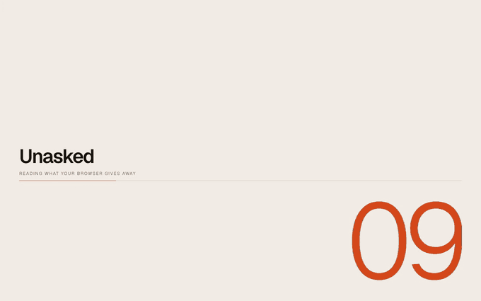
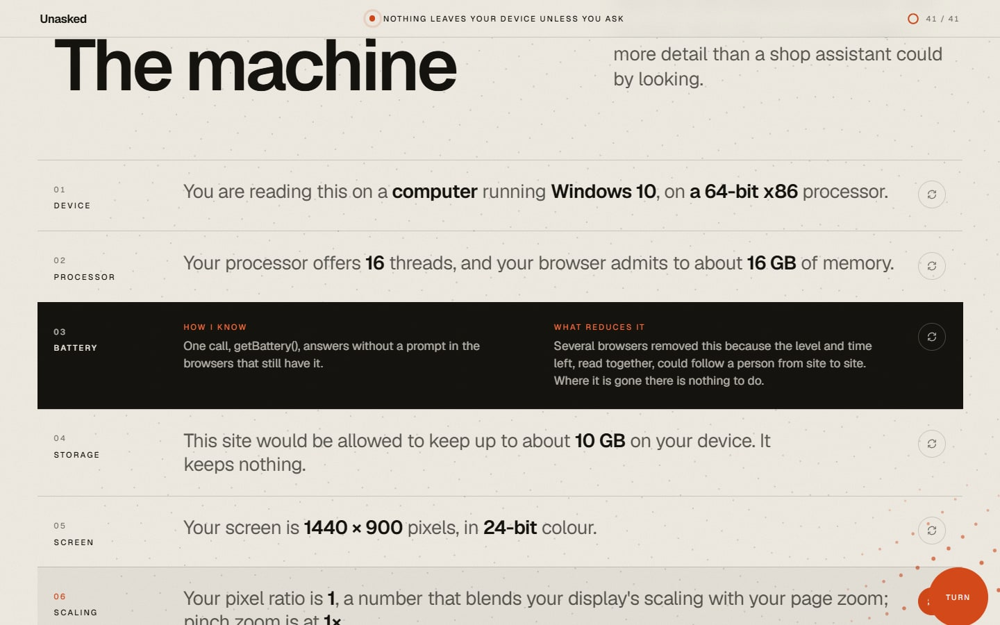
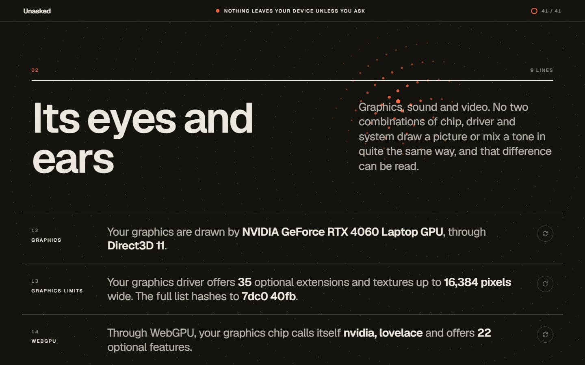
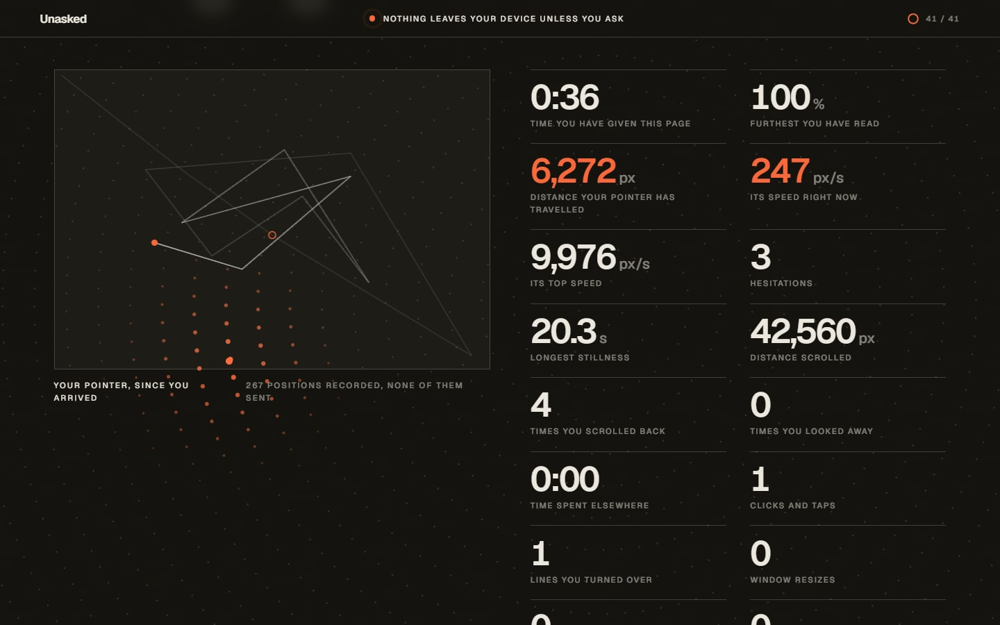
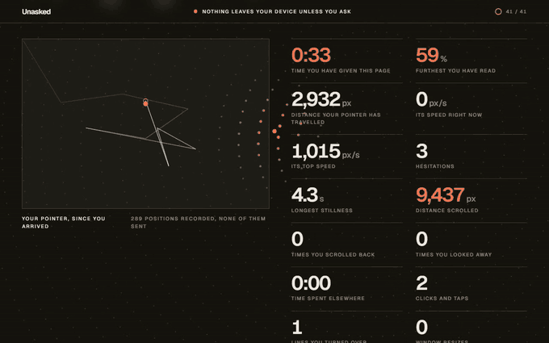
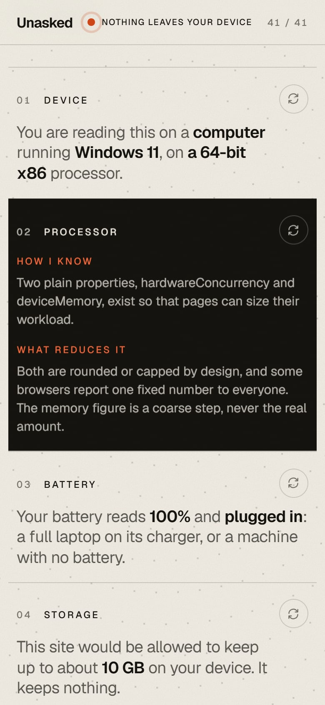
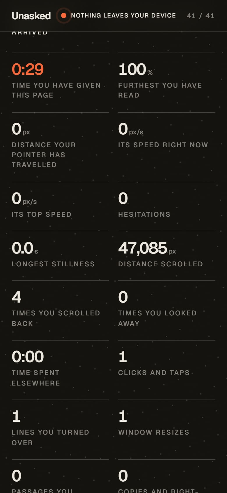

<picture>
  <source media="(prefers-color-scheme: dark)" srcset="assets/hero-dark.svg">
  
</picture>

<p align="center">
  <a href="https://pratyushshivam.github.io/unasked/"><b>Open it</b></a> ·
  <a href="#what-it-reads">What it reads</a> ·
  <a href="#nothing-leaves-your-device">The promise</a> ·
  <a href="#run-it">Run it</a> ·
  <a href="https://www.pratyushshivam.com/">pratyushshivam.com</a>
</p>

# Unasked

**The file your browser hands to every website.** Open the page and, with no clicks and no permission prompts, it writes out 41 plain sentences about you in six chapters: your machine, its graphics and sound, your software, where you are, how you got here and how fast your processor is. Then it shows, live, what a page learns by watching: where your pointer goes, when you hesitate, how far you read, the rhythm of your typing.

Every line turns over to show how the page found it out and what reduces it. At the end the answers travel into a single mark, the page recognises you if you come back, explains honestly what that does and does not prove, and tells you what you can do.

All of it is worked out on your own device. **Nothing is sent anywhere**, unless you press the one button that says it will make one request, and the page is built so that you can check.

**Open it:** [pratyushshivam.github.io/unasked](https://pratyushshivam.github.io/unasked/)

<a href="https://pratyushshivam.github.io/unasked/"></a>

<p align="center"><sub>The opening, the first chapter, and a line turning over. The whole page in one take: <a href="assets/film.mp4">film.mp4</a></sub></p>

<table>
<tr>
<td width="50%" valign="top"><br><sub><b>A chapter.</b> One line is turned over.</sub></td>
<td width="50%" valign="top"><br><sub><b>Paper turns to ink</b> from chapter to chapter.</sub></td>
</tr>
<tr>
<td width="50%" valign="top"><br><sub><b>Live.</b> Your pointer's path and what it says, updating as you move.</sub></td>
<td width="50%" valign="top"><br><sub><b>The mark.</b> One ring for each thing the page read.</sub></td>
</tr>
</table>

<a href="https://pratyushshivam.github.io/unasked/"></a>

<table>
<tr>
<td width="25%" valign="top"></td>
<td width="25%" valign="top"></td>
<td width="25%" valign="top"></td>
<td width="25%" valign="top"></td>
</tr>
</table>

<p align="center"><sub>The same page on a phone. It works by touch and by keyboard, and stays calm under reduced motion.</sub></p>

| | |
| :-- | :-- |
| **What it is** | One static page. No server, no account, no cookie |
| **What it reads** | 41 things a browser gives to any page without a prompt, and what you do while you read |
| **What it never does** | Ask for a permission, or read anything that needs one |
| **What it sends** | Nothing, unless you press the address button: then one request, to ipinfo.io. The Content-Security-Policy allows that address and no other |
| **What it keeps** | One note under a hundred bytes in this browser's own storage, to show what being recognised looks like. One click erases it |
| **Size** | About 340 kB for the page, its script, its styles and one font file |
| **Stack** | TypeScript and Vite. GSAP and Lenis for motion, bundled into the page. Signal modules are pure and tested |

## What it reads

<picture>
  <source media="(prefers-color-scheme: dark)" srcset="assets/line-dark.svg">
  
</picture>

Every line states only what the browser actually reported. Where a browser hides a value the line says "kept back" and credits the browser, and the mark draws that ring dotted. Nothing is guessed. Each line is one small module in [`src/signals`](src/signals).

| Chapter | Lines |
| :-- | :-- |
| **1. The machine** | Device, system and processor family · threads and memory · battery · storage allowance · screen · pixel ratio and pinch zoom · colour range, HDR, orientation · refresh rate (timed) · window · pointer and touch · game controllers |
| **2. Its eyes and ears** | Graphics chip · WebGL limits and extensions · WebGPU adapter · canvas fingerprint, drawn twice · audio fingerprint · arithmetic fingerprint · video and sound formats · kinds of camera and microphone present · speech voices |
| **3. What runs on it** | Browser, version and engine · 40 newer abilities tested by name · 52 fonts tested by measuring · plug-ins and PDF viewer · content blocker (a bait element) · traces left by extensions · automation flags · display and accessibility settings · Do Not Track and Global Privacy Control · places a site can keep things · permissions already held |
| **4. Where and who** | Clock and time zone · languages · date, time and number formats · keyboard layout · whether language and time zone agree |
| **5. The road here** | Referrer, reload or back, tracking tags in the address, history length · connection rating · how long the server took, from the browser's own timing record |
| **6. How fast** | A tenth of a second of fixed arithmetic, and a rough class · how finely the page's clock ticks |
| **7. Live** | Time on the page and time away · pointer distance, speed, hesitations · scroll depth and changes of mind · clicks, selections, copies, screenshot key · typing rhythm in a box (never the letters) · on touch screens, a guess at which thumb |
| **8. Only if you ask** | Your public address, the town it is registered near, your provider, and whether your clock agrees with it |

Several of these have been cut back by browsers in recent years, and the page is written for what they report today. The system version is taken only from client hints, because the old label is frozen. The storage figure is described as what it now is in Chromium, usage plus a fixed 10 GiB, not a measure of your disk. Media devices are reported as "at least one of each kind", because browsers now hide the count and the names until you grant access. The page never claims to detect a private window: browsers closed the tricks that did. The speed class is the page's own rough scale and it says so.

**What it will not do:** ask for a permission, probe which sites you are logged in to, scan your local network, or read your clipboard.

## The mark, and what it does not claim

At the end, each line travels to the centre and becomes a ring. A ring's shape comes from a hash of the answer, so the same answers always draw the same mark. Answers that hold still between visits are solid arcs. Answers that change by the minute are thin circles and are left out of the hash. Answers the browser refused are dotted.

Under the mark is the first 64 bits of a SHA-256 hash of the steady answers, computed by the browser's own Web Crypto. The page writes that mark and a visit count into this browser's storage, so on a second visit it can say "I know you. This is visit 2", and show that the mark alone would have been enough. The erase button removes the note.

**The page does not tell you that you are "one in N".** It cannot know. That figure needs everybody else's answers to compare yours with, which means collecting them, and this page collects nothing. What it does instead:

- It explains the idea accurately: an answer shared by half of all browsers carries one bit of identifying information, bits add up when answers are unrelated, and 33 bits are enough to tell apart everyone alive (2<sup>33</sup> = 8,589,934,592).
- It says why the simple sum overstates things: real answers are correlated, so the true figure can only be measured against a real crowd.
- It quotes two measurements that were made with consent, with their sample sizes: 83.6% of 470,161 browsers unique in the EFF's Panopticlick study (2010), and 33.6% of 2,067,942 on a large French website (2018).
- It computes only what can be computed locally: how many things it looked for, how many were answered, how many were refused, and how many are steady enough to go into the mark.

## Nothing leaves your device

<picture>
  <source media="(prefers-color-scheme: dark)" srcset="assets/boundary-dark.svg">
  
</picture>

The page is five static files: the HTML, one script, one stylesheet, one font and an icon. There is no backend, no analytics, no third-party script and no font or image fetched from anyone else. The motion libraries are bundled into the script. It sets no cookie.

This is enforced, not just promised. The first tag in the page is a Content-Security-Policy:

```
default-src 'none'; script-src 'self'; style-src 'self'; font-src 'self';
img-src 'self' data:; connect-src https://ipinfo.io; form-action 'none'; base-uri 'none'
```

`connect-src` names one outside address. The browser itself refuses `fetch`, `XMLHttpRequest`, WebSocket, EventSource and `sendBeacon` from this page to anywhere else, and `default-src 'none'` closes everything not listed. Outbound links carry no referrer.

**The one exception, and only if you ask.** Your public address is something every site sees and no page can read by itself. Chapter 8 offers a button that says exactly what it will do: one request to ipinfo.io, with no cookies and no referrer. The service sees your address, as any site you visit does, and nothing from the file. Until you press it, the count of outside requests on the page reads 0, and it is true.

### Check it yourself

1. **Watch the network.** Open the developer tools, choose Network, and reload. You will see the five files arrive, then nothing, however long you stay and whatever you do, short of pressing the address button.
2. **Read the policy.** View the page source. The policy above is at the top.
3. **Search the code.** The built script contains exactly one `fetch(`, and no `XMLHttpRequest`, `sendBeacon`, `WebSocket` or `EventSource`. CI fails the build otherwise:

   ```bash
   npm run build && grep -o "fetch(" dist/assets/*.js | wc -l
   ```

4. **Let a browser count.** `npm run shoot` opens the built page in Chrome at desktop size, phone size and with reduced motion, reads all of it, turns lines over by pointer and by keyboard, types in the box, and fails if any request is made after loading, if anything but the one note is stored, or if a cookie is set. A fourth visit presses the address button against a stand-in and fails unless that is the only request that leaves.
5. **Go offline.** Once the page is open, switch your connection off. Everything but the address button still works.

The page also shows its own receipt: the list of files your browser says it fetched, read from the Resource Timing record, and a count of anything fetched since.

**What is not in my hands.** The host that delivers the files sees your address and your browser's label, as every web server does. Here that host is GitHub Pages. If that matters to you, clone the repository and open the build from your own machine.

## What you can do

The page ends with six things, in plain words and with no product named:

1. Turn on the fingerprinting protection your browser already has.
2. Block the third-party scripts that ask the questions and record the session.
3. Customise less than you would like. Defaults are a disguise.
4. Keep separate things in separate browsers.
5. Stay up to date. Browsers keep closing these windows.
6. Know what the usual tools do not do: a private window and a VPN leave almost all of this untouched.

## Run it

Needs Node.js 22 or newer.

```bash
npm install
```

```bash
npm run dev
```

Then open the address it prints.

| Command | What it does |
| :-- | :-- |
| `npm run dev` | Development server |
| `npm run build` | Type check, then a static build in `dist/`, ready for any static host |
| `npm test` | 83 unit tests: every signal module, the dossier, the mark, behaviour, return visits, the address lookup |
| `npm run typecheck` | TypeScript, no emit |
| `npm run shoot` | Opens the built page in Chrome and checks the network, storage, layout and keyboard. Start `npm run preview -- --port 4621` first |
| `npm run readme` | Rebuilds the graphics on this page |

## How it is put together

```
src/signals      one small module per line of the file. Each takes plain data and returns a sentence,
                 how it was found, what reduces it, and whether it is steady. No browser objects.
src/collect.ts   the only file that reads the browser: raw values in, plain data out
src/profile.ts   the six chapters, in order, and the count of what was answered and refused
src/behaviour.ts what watching reveals, as a tally fed with numbers
src/recognise.ts the note for return visits
src/address.ts   the one outside lookup, and how its answer is read
src/mark.ts      ring geometry and hashing for the mark
src/ui           the page: motion, the turning cards, the live panel, the ending
tests            made-up browsers: one that answers everything, one that hides most
scripts          the browser check, the screenshots and film, the graphics on this page
```

The split matters for honesty as much as for testing. Because every sentence is produced by a pure function, the tests can hand it a browser that refuses to answer and check that the line says "kept back" and that nothing refused ever reaches the mark.

### Sources

- Bits of identifying information, and the first large measurement: [P. Eckersley, How Unique Is Your Web Browser? (2010)](https://coveryourtracks.eff.org/static/browser-uniqueness.pdf)
- The later, lower figure on a general audience: [A. Gómez-Boix, P. Laperdrix, B. Baudry, Hiding in the Crowd (2018)](https://doi.org/10.1145/3178876.3186097)
- The storage figure in Chromium: [Predictable reported storage quota](https://groups.google.com/a/chromium.org/g/blink-dev/c/7q0YGQNVkjs)
- The memory figure: [W3C Device Memory API](https://www.w3.org/TR/device-memory-1/)
- The policy: [W3C Content Security Policy Level 3](https://www.w3.org/TR/CSP3/)

The screenshots and film are of the real page in Chrome on an ordinary laptop, with the browser's time zone set to London and its language to British English. Where the address lookup appears, it was answered by a stand-in with a documentation address, so no real address is shown. The mark in the graphics is drawn from sample answers, not from anyone's browser.

## Licence

[MIT](LICENSE). The Geist typeface is used under the SIL Open Font License. GSAP is used under its standard no-charge licence, and Lenis under MIT.

<p align="center"><sub>Built by <a href="https://www.pratyushshivam.com/">Pratyush Shivam</a>. The graphics on this page are hand-built SVG with CSS animation, drawn by the same ring geometry the page uses. They follow your light or dark theme.</sub></p>
